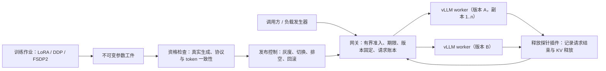

# LLM Serving Lab：可持续更新的大模型推理服务

在 vLLM 前面加一层可审计的推理网关。新的参数版本先通过资格检查，再灰度、切换、排空和回滚；网关逐请求记录去向、实际版本、耗时，并核对引擎里的计算与 KV 缓存确实已释放。训练产物（LoRA 或全参数）走同一条发布流程上线。

> 个人工程项目。所有结果来自一台 RTX 4080 Laptop（WSL2），以及一次租用的阿里云两节点 A10 集群；不是生产系统，数字只在各自注明的条件下成立。模型权重与原始运行数据（约 200 GB）不在仓库中，结果页写明了每项数据的测量条件。

## 它解决什么问题

- **换版本时不打断在途请求**：请求准入时固定版本，切换路由后，已排队和生成中的请求仍由原版本完成；旧版本排空后才下线，资格不通过的版本不能上线，可回滚到之前的版本。
- **超时、断开、崩溃时资源真的被释放**：取消会传到引擎，并通过 vLLM 插件记录的释放事件确认 KV 引用已解除；网关崩溃后，未确认的调用标为 unknown；重启后同一个幂等键再次提交返回 409，不会被重复执行。
- **训练产物要先过资格再发布**：LoRA 冷启动、增量更新、分布式训练导出的参数，都先在真实 worker 上做资格检查，再进入同一套发布与回滚流程。

## 系统结构



- **网关**（`src/serving_lab/online.py`）：FastAPI 实现的 OpenAI 兼容入口，限制请求体、输入/输出 token、并发与队列，从到达时刻计算绝对期限。
- **请求账本**（`runtime.py`）：SQLite WAL + `synchronous=FULL`，记录每次到达、绑定、派发、终态与清理证据；派发到引擎之前先持久化（写前确认），多个操作合并为一次组提交。
- **发布控制**（`releases.py`、`replicas.py`）：版本状态机 registered → ready → canary/active → draining → retired；副本池把“发布版本”和“具体 worker 代际”分开，worker 换代必须重新资格。
- **集群部署**（`deployment/`）：K3s 三节点、两台 A10 GPU 节点各一个副本，worker 与网关之间使用双向 TLS，生成请求携带期望的 worker 代际，由 worker 端拒绝不匹配的请求。

## 主要结果

| 主题 | 条件 | 结果 |
|---|---|---|
| 网关热路径优化 | 本机 RTX 4080；同一对 vLLM 引擎上直连、基线网关、优化网关交替测量，每轮 1,536 个请求 | 逐请求阶段计时定位：派发前约 17 ms 网关耗时里，两次同步就绪检查约占 60%、4 次 FULL 提交约占 30%。改为后台健康探测与账本组提交后，派发前耗时约 17 → 4 ms，经网关的额外首 token 等待中位数 17.2–21.0 → 5.8–7.8 ms，降 56%–72%（过载层除外）；FULL 持久化与派发前写前确认不变，并通过真实故障矩阵回归 |
| 双节点集群固定负载 | 阿里云 2×A10、K3s、mTLS，固定短命令负载 8 req/s | 主负载 960/960、留出 288/288 达标；首 token P95 104 ms / 158 ms |
| 受控发布与热回滚 | 两个不同参数版本，云端两台 A10，50% 哈希灰度 | 灰度请求与哈希分桶规则逐条一致；切换前已准入、切换后才派发的 15 个请求仍由原版本完成；热回滚通过 |
| 训练产物接入 | ALFWorld，Qwen3-1.7B，场景隔离的 24 个开发任务 | 原模型 0/24、固定两条示范 0/24，LoRA 冷启动后 23/24；一轮更新后旧技能 23/23 保持 |
| 量化的质量门 | Qwen3-4B，同一 A10 与负载，GSM8K 固定 256 题 | AWQ 每 token 解码 21.4 → 8.4 ms（256/128 形状），但准确率 233 → 223/256（−3.9 个百分点），超过 2 个百分点的门槛，拒绝采用 |
| 分布式训练与恢复 | Qwen3-0.6B 全参数，两机各一张 A10，NCCL 走普通内网 | DDP / FSDP2 与单卡逐步 loss 相对差 ≤ 4.1e-7；从检查点恢复后与不中断训练逐步一致；FSDP2 每卡显存 14.5 → 9.5 GiB；该网络条件下两机都比单卡慢（NCCL kernel 占 GPU 活跃时间 85%–98%，含等待） |

系统设计见 [docs/design.md](docs/design.md)；各项的详细记录、测量条件和原始数据位置见 [docs/README.md](docs/README.md)。

## 没有成功或尚未完成的部分

- **自写 CUDA 算子未采用**：residual RMSNorm 通过了 81 个数值场景和 Compute Sanitizer，也确认在 Qwen3-4B 中实际执行，但多数形状比 vLLM 自带实现慢，整模型逐 token 一致性只有 1/16，因此没有替换。
- **持续学习研究未完成**：项目原计划研究“经验能否通过权重更新变成技能”。目前完成了任务环境、强外部记忆对照和一次共享基础适配（基础任务 23/24），但流程遵循仍未达到预先设定的门槛，主实验没有启动。
- **单机多卡训练未测**：分布式只测了两机各一卡，同一台机器上的多卡对照没有做。
- **规模有限**：单个发布控制者，没有控制面高可用；云端只测了固定短命令负载，不能外推到长生成或生产容量。

## 快速开始

只需要 CPU 的单元测试（Python 3.12，[uv](https://docs.astral.sh/uv/)）：

```bash
uv sync --locked
uv run pytest -q
```

真实 GPU 环境（vLLM 0.11.2、PyTorch 2.9.0+cu128）的安装、启动与故障验收见 [environments/serving-linux/README.md](environments/serving-linux/README.md)。网关 A/B 测量入口是 `scripts/run_gateway_ab.py`，报告由 `scripts/report_gateway_ab.py` 从原始窗口重算。

## 目录

| 路径 | 内容 |
|---|---|
| `src/serving_lab/` | 网关、账本、发布控制、副本池、worker 协议、训练与评价工具 |
| `tests/` | CPU 单元与合同测试（GPU 相关部分用合同替身） |
| `scripts/` | 引擎启动、真实故障验收、负载测量、审计与报告脚本 |
| `deployment/` | 容器镜像、K3s 部署与集群操作 |
| `environments/` | 各运行环境（推理、训练、量化、任务环境）的锁定依赖 |
| `experiments/cuda_norm/` | CUDA 算子实验（未采用） |
| `docs/` | 设计记录、结果页与操作手册 |

## License

[MIT](LICENSE)
