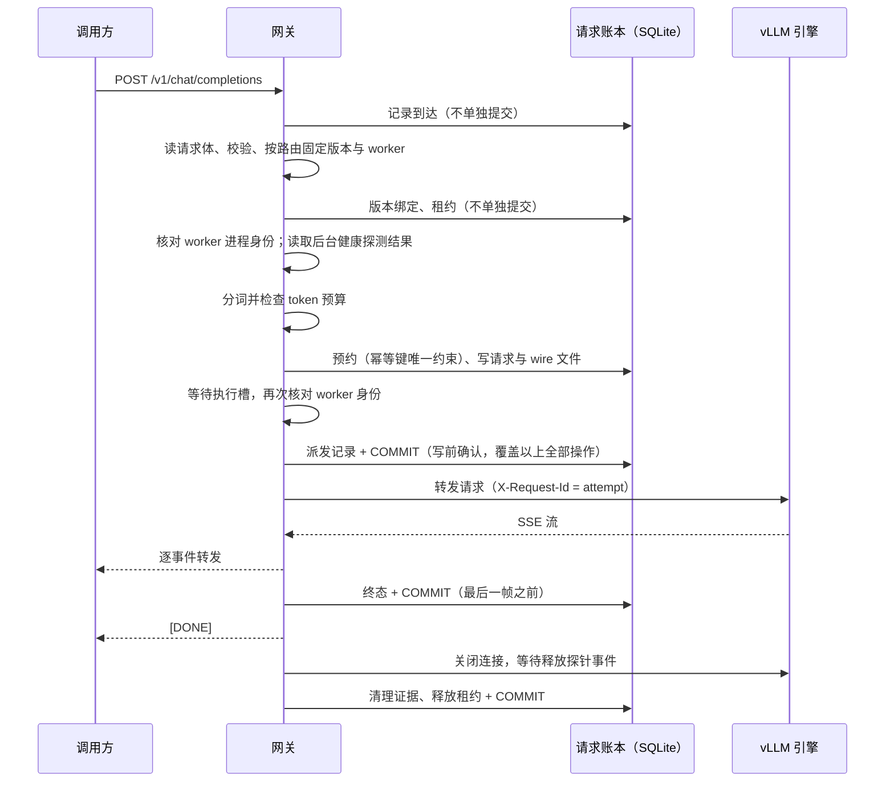

# 设计说明

本文说明系统由哪些部分组成、各自保证什么，以及这些保证在故障时如何成立。实测结果见 [docs/README.md](README.md) 列出的结果页。

## 1. 目标与边界

目标是让一组 vLLM 推理实例可以被持续地更新：新参数版本经过资格检查后再灰度、切换、排空和回滚，期间每个请求的去向、实际版本、耗时和资源释放都可以事后核对。

不在范围内：计费与多租户、控制面高可用（同一时刻只有一个发布控制者）、对管理员篡改文件的防护（信任本机操作者与受控 worker）。

## 2. 组件

| 组件 | 代码 | 职责 |
|---|---|---|
| 网关 | `online.py` | OpenAI 兼容的 `/v1/chat/completions`，有界准入、排队、绝对期限、取消传播；逐请求记录阶段时刻 |
| 请求账本 | `runtime.py` | SQLite（WAL、`synchronous=FULL`）保存到达、版本绑定、预约、派发、终态、清理证据与租约 |
| 引擎适配 | `engine.py`、`worker_protocol.py` | 本机 vLLM（HTTP）或远端 worker（双向 TLS）；分词、派发、等待释放证据、就绪检查 |
| 释放探针 | `engine_probe.py` | vLLM 插件：在 Scheduler 释放请求的 KV 块后，记录请求 ID、KV 引用是否全部解除、进程与启动代际 |
| 发布控制 | `releases.py` | 版本状态机、路由代际（generation）、灰度百分比；资格回执绑定参数、profile 与 worker 身份 |
| 副本池 | `replicas.py`、`replica_api.py` | 把“发布版本”与“具体 worker 代际”分开：容量、隔离、换代后重新资格 |
| 训练与资格 | `train.py`、`coldstart_train.py`、`distributed_study.py`、`qualification.py` | LoRA / 全参数训练回执；固定资格面板（普通、流式、重复、1 token 截断） |

## 3. 请求合同

- **准入**：请求体大小、消息数、输入 token、输出预算、并发与队列都有上限；超出时在派发前拒绝。期限从到达时刻起算，包含读请求体、分词、排队和生成。
- **版本固定**：准入时解析 `model`（具体版本或 `active` 别名），把整次尝试绑定到一个版本和一个 worker 代际。排队或生成期间发生的路由切换不改变在途请求。
- **到达与去重**：每次到达都有服务器生成的 `X-Arrival-Id`；客户端的 `Idempotency-Key` 另存，重复键返回 409，但重复的那次到达本身也记账。
- **单一终态**：completed、failed、rejected、timed_out、cancelled、unknown 之一，只写一次。
- **取消与释放**：客户端断开、期限到达或服务关闭时，关闭到引擎的连接，再等待释放探针的事件确认该请求的 KV 引用已全部解除。确认不了就把清理记为 unconfirmed：单版本或发布控制器模式下整个网关停止准入，副本池模式下只隔离该副本。“HTTP 连接已关闭”不等于“资源已释放”。
- **不自动重试**：网关不会替客户端重发请求，流式输出开始之后更不会静默重发。

### 一次流式请求的处理顺序

## 4. 发布合同

版本状态：registered → validated → loading → ready → canary → active → draining → retired，任一步可以进入 failed。

- 只有在真实 worker 上通过资格面板的版本才能进入 ready；profile（模板、解码参数、上下文与输出上限、实现摘要）变化后必须重新资格。
- 路由变更要求带上当前 generation，过期的变更被拒绝；灰度按到达 ID 的哈希分桶，同一请求的路由可复算。
- 被替换的版本进入 draining，等在途租约全部释放后才能 retire；回滚只允许回到曾经 active 且仍合格的版本。
- 同一参数换个名字不能算作两个版本；worker 换代必须显式重新绑定并重新资格，不自动继承旧流量。

## 5. 持久化与故障语义

账本的每个操作是当前批量事务里的一个保存点，失败只回滚这个操作；COMMIT（含 fsync）只在持久化边界执行：

1. **派发到引擎之前**——写前确认：引擎看到请求之前，派发记录以及此前的到达、绑定、预约都已落盘；
2. **向客户端返回之前**——非流式响应、各种拒绝，以及流式响应的最后一帧（`[DONE]` 或错误帧）；
3. **清理结束时**——终态、清理证据与租约释放一次提交，然后才归还执行槽。

一次 COMMIT 覆盖此前所有已执行的操作，并发请求自然共享同一次提交；一个流式请求共提交 3 次，派发前只有 1 次。提交失败、或 SQLite 因语句错误整体回滚了未提交的批次时，账本立即关闭写入，网关对新请求返回 503，已在途的请求照常归还执行槽与容量。

控制者崩溃后重启：所有非终态请求标为 unknown；已派发而清理未确认的请求，先用释放探针的历史记录核对；核对不了的保持未解决，网关不就绪（副本池模式下只隔离相关副本）。重启后同一幂等键仍返回 409，不会重新执行。既没有派发、也没有返回响应的到达，可能随最后一个未提交批次丢失——它们没有产生任何对外可见的效果。

## 6. 就绪检查

- 每个请求：核对 worker 主进程和 Scheduler 进程的身份（PID、启动时刻、boot ID）。同一端口被替代实例接管时立即判为未就绪。
- 后台每 0.2 秒：核对启动清单文件未被修改，并请求引擎 `/health`；通过结果从探测开始算最多复用 0.5 秒，失败不缓存。同一时刻只有一次在途探测，等待者共享它的结果（无论成败），挂起的 worker 不会让请求排队重试；副本池在后台探测运行时只读取最近结果，不等待某个挂起副本。
- 远端 worker：生成请求带 `X-Expected-Worker`，worker 端对不匹配的代际直接拒绝，不依赖网关的就绪结果。

## 7. 集群部署

阿里云同地域四台机器：控制节点、两台 A10 GPU 节点（K3s 三节点集群），以及独立的负载机。每台 GPU 节点运行一个 vLLM worker 和一个 worker 桥（`worker_protocol.py`），网关只通过双向 TLS 与 worker 桥通信；负载机同样经双向 TLS 访问网关。镜像与依赖版本固定在 `deployment/images.lock.json` 和各环境的 `uv.lock`。

## 8. 测量方法

- **开环负载**：按预定时刻发送，不因前一个请求慢而推迟；发送迟到超过阈值的请求计为失败，不补发成突发。
- **配对**：同一批固定输入（同一 seed）分别走直连和网关，按输入逐条配对计算额外等待；直连与网关窗口的先后顺序轮换。
- **SLO**：首 token ≤ 1 秒，16 token 输出的端到端 ≤ 5 秒、128 token ≤ 10 秒；SLO 比例的分母是全部计划请求。
- **原件审计**：报告从原始窗口事件重算；逐条核对账本终态、清理证据、租约释放与实际发送给引擎的 token。

## 9. 已知限制

- 单一发布控制者，没有控制面高可用。
- 健康结果有效期内（0.5 秒）引擎若挂起但进程仍在，请求会等到期限（504）而不是立即 503。
- 云端只测了固定短命令负载；本机测量都在同一块笔记本 GPU 上。
